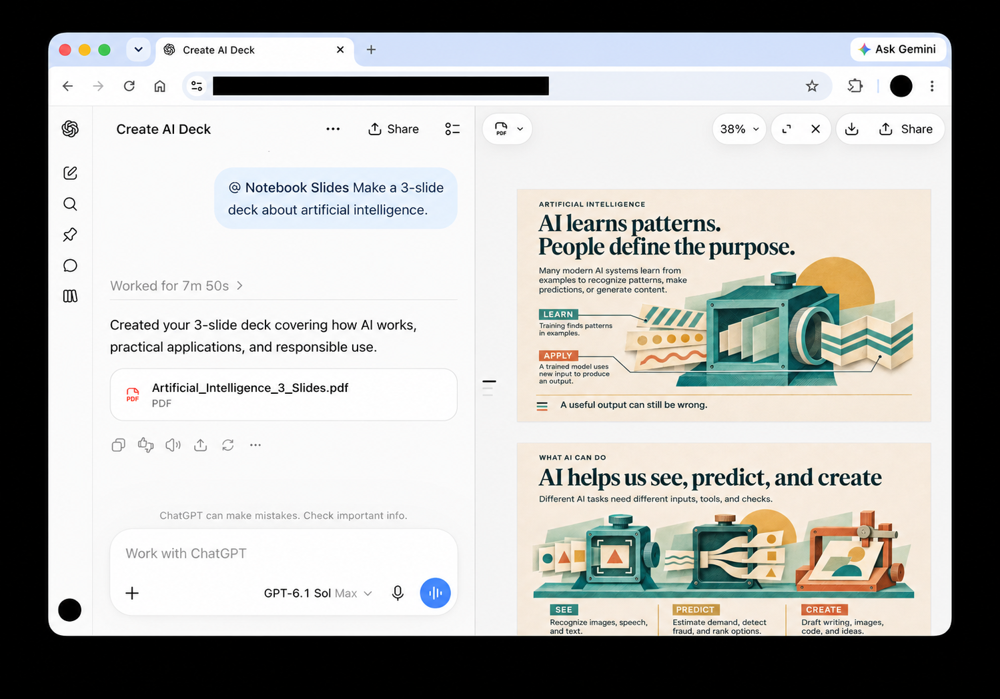

# Notebook Slides — Gemini Notebook-style presentations

**The impressive slide style of Gemini Notebook (formerly NotebookLM), right in ChatGPT.**

Turn your notes, reports, or ideas into richly illustrated presentations—with expressive artwork, thoughtful layouts, and a consistent style designed around your topic.

## Get started

1. [**Download Notebook Slides**](https://github.com/niusann/notebook-slides-skill/releases/latest/download/notebook-slides-plugin.zip).
2. Install the downloaded bundle through your assistant’s plugin installation option, then select **Notebook Slides** in a chat.
3. Share your notes or attach a report, and ask for a presentation.

Just specify **PowerPoint** or **PDF** in your prompt. One download includes both options.

## Try it

> Make a 10-slide presentation about artificial intelligence in the visual style of Google Gemini Notebook (formerly NotebookLM). Use warm colors and playful illustrations. Deliver it as an editable PowerPoint.

> Turn this report into a presentation for our leadership team. Focus on the key findings and next steps. Give me a PDF.

Notebook Slides guides you through the outline, visual theme, and slide designs before creating your deck. You can ask for changes along the way—or say **“just generate it”** to go straight to the result.

For the best result, mention your audience and preferred slide count. Your assistant needs image generation and file creation enabled. Allow a few minutes for the deck to be created, and review it before presenting.
